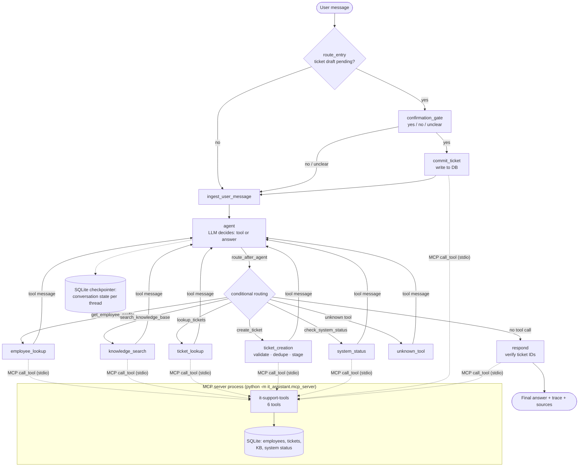

# 🛠️ AI IT Support Assistant: an agentic workflow with LangGraph, OpenAI and MCP

An AI IT support assistant for a fictional company (Contoso Ltd.). It understands an employee's request, decides whether a tool is needed, picks and runs the right tool against local data, and replies in plain language. It also keeps track of who the user is and what they asked for across the conversation.

> **Concepts demonstrated:** Tool calling → Agent → State → Routing → Multi-step workflow, with human-in-the-loop confirmation and guardrails. The tools are served over the **Model Context Protocol (MCP)**.

---

## 1. Problem statement

Employees raise the same IT questions again and again: "how do I reset my VPN password?", "what's happening with my laptop ticket?", "is email down?". A service desk agent has to look in several places (knowledge base, ticketing system, status board, employee directory) to answer them. A plain chatbot can't help here. It doesn't know company data, it can't act, and it may make up ticket numbers.

## 2. Solution overview

An **agent** built on **LangGraph** that uses an **OpenAI** model (Chat Completions API) for reasoning and **function calling**. Its five tools are served by a separate **MCP server** (Model Context Protocol), which the agent discovers and calls as an MCP client:

| # | Tool | What it does | Data source |
|---|------|--------------|-------------|
| 1 | `search_knowledge_base` | BM25 search over IT how-to articles | `kb_articles` table |
| 2 | `lookup_tickets` | Finds the verified employee's tickets (by ID, status, keyword) | `tickets` table |
| 3 | `create_ticket` | Validates, checks for duplicates, stages a draft, and creates it **only after the user confirms** | `tickets` table |
| 4 | `get_employee_profile` | Verifies the employee ID and loads the profile into state | `employees` table |
| 5 | `check_system_status` | Live health of VPN, Email, Wi-Fi, SSO and other systems | `system_status` table |

The data lives in **SQLite**, and only the MCP server process opens it. It is seeded automatically from the JSON files in [`data/seed/`](data/seed/) the first time the app runs. The UI is built with **Streamlit**. It has a chat window, conversation history, a reset button, a visible agent trace for each answer, labels showing where data came from, and confirm/cancel buttons for tickets.

## 3. Architecture



The agent and the tools run as **two processes**. When the app starts, `AgentService` launches the MCP server as a subprocess and connects to it over **stdio** (JSON-RPC messages on stdin/stdout). It then calls `list_tools` to discover the tool schemas and sends every tool call through `call_tool`.

`docs/graph.mmd` is generated from the compiled graph by `python -m scripts.export_graph`, so it always matches the code.

### MCP (Model Context Protocol)

| Piece | Where | What it does |
|---|---|---|
| **MCP server** | [`mcp_server/server.py`](it_assistant/mcp_server/server.py) | `MCPServer("it-support-tools")` publishes 6 tools. Input schemas are generated from Python type hints (`Literal` becomes an enum, `Field(description=...)` a parameter description, the docstring the tool description). It owns the database and the business logic (`ToolExecutor`). |
| **Server entry point** | [`mcp_server/__main__.py`](it_assistant/mcp_server/__main__.py) | `python -m it_assistant.mcp_server` runs the server over stdio. It logs to stderr and `var/logs/mcp_server.log`, never stdout, which carries the protocol. |
| **MCP client** | [`tools/mcp_backend.py`](it_assistant/tools/mcp_backend.py) | `MCPToolBackend` starts the server, keeps one `mcp.Client` session open on a background event-loop thread (LangGraph and Streamlit are synchronous, the MCP SDK is async), converts MCP tool schemas to OpenAI function format, and turns every result into a `ToolResult`. |
| **Tool policy** | [`tools/definitions.py`](it_assistant/tools/definitions.py) | Decides what the LLM may see. `commit_ticket` is **internal**: it is never offered to the model, so only the confirmation gate can call it. `employee_id` is **injected from verified state** for ticket tools and removed from the schema the model sees. |

Because the tools speak a standard protocol, any MCP-capable client (another agent, an IDE, Claude Desktop) could reuse them without code changes.

### How each required concept is implemented

| Concept | Where |
|---|---|
| **Tool / function calling** | Tool schemas are discovered from the MCP server (`list_tools`) and sent to the model as OpenAI `tools`. The model returns `tool_calls`. The graph runs each one through MCP `call_tool` and sends back a `role: "tool"` message ([`agent/nodes.py`](it_assistant/agent/nodes.py)). |
| **Agent** | The `agent` node: the LLM decides whether a tool is needed, which one, and with what arguments, or it writes the final answer. |
| **State** | `AgentState` in [`agent/state.py`](it_assistant/agent/state.py) holds the transcript, verified employee, pending ticket draft, trace and sources. It persists across turns through the **SQLite checkpointer**, one `thread_id` per conversation. |
| **Nodes / edges** | [`agent/graph.py`](it_assistant/agent/graph.py): 11 nodes, normal edges, and 3 conditional routers. |
| **Conditional routing** | `route_entry` (is confirmation pending?), `route_after_confirmation` (yes/no), `route_after_agent` (which tool node, or respond). |
| **Multi-step workflow** | Every tool node loops back to `agent`, so the LLM can chain calls (verify employee → look up tickets → answer). A step limit prevents endless loops. |
| **Response generation** | The LLM writes the answer from the tool results. The `respond` node then checks every ticket ID mentioned against the database before the answer is shown. |
| **Memory** | The spec example ("I have a VPN issue" → "EMP1024" → "Yes") works because the employee and transcript live in persisted graph state. See `test_memory_employee_then_ticket_lookup`. |

## 4. Safety and validation

| Requirement | Implementation |
|---|---|
| Validate before creating a ticket | `validate_ticket_request()` re-checks every field the LLM provides: required fields, allowed category and priority values, length limits. Missing fields are sent back to the LLM, which asks the user. |
| Don't execute blindly | `create_ticket` **only stages a draft**. The deterministic `confirmation_gate` node and the UI's ✅/❌ buttons need an explicit "yes" before `commit_ticket` writes anything. A reply like "yes but make it critical" counts as *unclear*, so the LLM revises the draft instead of submitting it. |
| No duplicate tickets | Before staging, open tickets with the same category and similar text (Jaccard similarity) are flagged as a `possible_duplicate`. The LLM shows the existing ticket and only continues if the user says it's a different issue. |
| Identity comes from state, not the LLM | The MCP client removes `employee_id` from the ticket tools' schemas before the model sees them, and fills it in from verified graph state on every call. A forged `employee_id` argument is discarded. Asking for another employee's ticket ID returns "not found". |
| The model can't write directly | The write tool `commit_ticket` exists on the MCP server but is **never offered to the model**. If the model invents a call to it, the graph routes it to `unknown_tool`. Covered by `test_model_cannot_call_internal_commit_tool`. |
| Clear message when info is missing | Tools return a `needs_input` status listing the missing fields. The system prompt tells the LLM to ask for them in one message. |
| Tool failures handled gracefully | Tool crashes, an unreachable MCP server, timeouts and invalid arguments all become error or `needs_input` tool results. Each tool also runs inside a try/except. LLM/API errors are mapped to friendly messages (rate limit, timeout, auth, and so on). The transcript stays valid, so the conversation can continue. |
| Don't invent ticket info | The prompt says to state only facts from tool results. In addition, the `respond` guardrail checks every `INC######` in the answer against the DB and adds a ⚠️ warning for any it can't verify. |
| Retrieved vs generated | Every answer shows **"Retrieved from company systems: 📘 KB-001 · 🎫 INC100231"** or **"AI-generated response, no company records used"**. The prompt also requires KB citations and labels general advice as such. |
| Prompt-injection hardening | Application events reach the LLM as `<workflow_event>` blocks. If a user types that tag, it is escaped, so users can't forge "ticket created" events. |
| Input limits | Empty messages and messages over `MAX_USER_MESSAGE_CHARS` are rejected before reaching the graph. |

## 5. Technology stack

| Layer | Technology |
|---|---|
| Language | Python 3.11+ (developed on 3.14; Docker image uses 3.12) |
| Orchestration | LangGraph 1.2 (StateGraph, conditional edges, SQLite checkpointer) |
| LLM | OpenAI (`gpt-5.4-mini` by default, configurable) via the official `openai` Python SDK, Chat Completions + function calling |
| Tool protocol | MCP (Model Context Protocol) via the official `mcp` Python SDK 2.x: `MCPServer` + `Client`, stdio transport |
| Data | SQLite (seeded from JSON) |
| Retrieval | BM25 keyword search (pure Python, no extra model) |
| UI | Streamlit 1.65 |
| Config | `.env` + environment variables (`python-dotenv`) |
| Testing | pytest, with a scripted fake LLM and the real MCP server (in-process, plus one stdio test). No network or API key needed |
| Deployment | Docker, docker-compose, Bitbucket Pipelines / GitHub Actions CI |

## 6. Project structure

```
├── app.py                         # Streamlit entry point
├── it_assistant/
│   ├── config.py                  # Settings from env vars, with validation
│   ├── logging_config.py          # Console + rotating file logs
│   ├── agent/
│   │   ├── state.py               # AgentState (LangGraph state schema)
│   │   ├── prompts.py             # System prompt + per-turn session context
│   │   ├── llm.py                 # OpenAI client wrapper + error mapping
│   │   ├── nodes.py               # Graph nodes, routers, guardrails
│   │   ├── graph.py               # StateGraph wiring
│   │   └── service.py             # AgentService: chat / reset / session API
│   ├── mcp_server/
│   │   ├── server.py              # MCP server: the 6 tools and their schemas
│   │   └── __main__.py            # python -m it_assistant.mcp_server (stdio)
│   ├── tools/
│   │   ├── definitions.py         # Tool names + agent-side tool policy
│   │   ├── mcp_backend.py         # MCP client: discovery, schema conversion, call_tool
│   │   ├── executor.py            # Tool business logic (runs inside the MCP server)
│   │   └── results.py             # ToolResult / Source shared by server and client
│   ├── services/
│   │   ├── knowledge_search.py    # BM25 index
│   │   ├── validation.py          # ID formats, ticket validation rules
│   │   └── text.py                # Tokenizer, similarity
│   ├── data/
│   │   ├── database.py            # Schema, connections, seeding
│   │   ├── models.py              # Dataclasses
│   │   └── repositories.py        # All SQL lives here
│   └── ui/components.py           # Streamlit rendering helpers
├── data/seed/                     # Sample data (employees, tickets, KB, system status)
├── scripts/
│   ├── init_db.py                 # Create / reset the database
│   └── export_graph.py            # Export the LangGraph diagram (docs/graph.mmd)
├── tests/                         # 53 tests: tools, MCP layer, end-to-end graph flows
├── docs/graph.mmd                 # Auto-generated graph diagram
├── Dockerfile, docker-compose.yml, bitbucket-pipelines.yml, .github/workflows/ci.yml
├── requirements.txt, requirements-dev.txt, .env.example, pyproject.toml
```

## 7. Setup

**Prerequisites:** Python 3.11+ and an OpenAI API key from https://platform.openai.com/api-keys.

```bash
git clone <your-repo-url> it-support-assistant
cd it-support-assistant
python -m venv .venv
```

Activate it with `.venv\Scripts\activate` on Windows, or `source .venv/bin/activate` on macOS/Linux. Then:

```bash
pip install -r requirements-dev.txt
cp .env.example .env        # Windows: copy .env.example .env
```

Edit `.env` and set `OPENAI_API_KEY`.

### Environment variables

| Variable | Required | Default | Purpose |
|---|---|---|---|
| `OPENAI_API_KEY` | **yes** | - | OpenAI API key |
| `OPENAI_MODEL` | no | `gpt-5.4-mini` | Any chat model that supports function calling |
| `OPENAI_REASONING_EFFORT` | no | *(empty)* | `minimal`/`low`/`medium`/`high`, for reasoning models only. Leave empty for gpt-4.1/gpt-4o |
| `OPENAI_BASE_URL` | no | *(OpenAI)* | Custom endpoint, e.g. a proxy |
| `LLM_MAX_TOKENS` | no | `8000` | Max output tokens per call |
| `LLM_TIMEOUT_SECONDS` / `LLM_MAX_RETRIES` | no | `90` / `3` | API timeout and automatic retries (429/5xx/network) |
| `MCP_CALL_TIMEOUT_SECONDS` / `MCP_STARTUP_TIMEOUT_SECONDS` | no | `30` / `30` | Timeouts for MCP tool calls and server start-up |
| `MAX_AGENT_STEPS` | no | `6` | Max LLM calls per user turn |
| `MAX_USER_MESSAGE_CHARS` | no | `2000` | Input length limit |
| `KB_TOP_K` / `KB_MIN_SCORE` | no | `3` / `0.5` | Knowledge search tuning |
| `DUPLICATE_SIMILARITY_THRESHOLD` | no | `0.35` | Duplicate-ticket sensitivity |
| `DATABASE_PATH` / `CHECKPOINT_DB_PATH` | no | `var/...` | SQLite files |
| `LOG_LEVEL` / `LOG_DIR` | no | `INFO` / `var/logs` | Logging |

## 8. Running

```bash
streamlit run app.py
```

Then open http://localhost:8501. The app starts the MCP tool server automatically, and the database is created and seeded on first start.

To run the MCP server on its own (for example, to connect another MCP client or the MCP Inspector):

```bash
python -m it_assistant.mcp_server
```

To reset the demo data (this also removes created tickets and saved conversations):

```bash
python -m scripts.init_db --reset
```

To run the tests (no API key needed):

```bash
python -m pytest
```

To run with Docker:

```bash
docker compose up --build
```

## 9. Sample inputs and expected behaviour

Demo employee IDs: `EMP1024` (laptop ticket in progress), `EMP1001` (open VPN ticket, use this for the duplicate demo), `EMP1006` (inactive account, use this for the validation demo).

> The model's exact wording changes from run to run. The **tool route, the data and the guardrail behaviour** shown below are deterministic.

**A. Knowledge search**
```
User:  How do I reset my VPN password?
Trace: agent → knowledge_search(query="reset VPN password") → agent → respond
Bot:   Your VPN password is your corporate SSO password (KB-001):
       1. Go to https://password.contoso.example and click "Forgot password" …
       Retrieved from company systems: 📘 KB-001 · 📘 KB-003
```

**B. Memory across turns + ticket lookup** (the scenario from the brief)
```
User:  I have a VPN issue.
Bot:   I can help. What's your employee ID?
User:  EMP1024.
Trace: agent → employee_lookup → agent → respond
Bot:   Thanks, Ananya, I found your profile. Would you like me to check your existing tickets?
User:  Yes.
Trace: agent → ticket_lookup(status="open") → agent → respond
Bot:   You have one open ticket: INC100231 "Laptop battery drains within an hour",
       in progress with Desktop Support. Note: a replacement battery is expected on 2026-10-10.
```

**C. Ticket creation with confirmation**
```
User:  My VPN is not working. Please raise a ticket.
Bot:   (checks system status → VPN degraded on APAC-South) … asks for details if any are missing
User:  It says authentication failed since this morning, I can't work.
Trace: agent → ticket_creation → status=confirmation_required
Bot:   Here's the ticket I'll raise: VPN authentication fails · priority high … Shall I create it?
       [✅ Create ticket] [❌ Cancel]
User:  yes
Trace: confirmation_gate(yes) → commit_ticket → agent → respond
Bot:   Done. Your ticket INC100246 has been created and assigned to Network Operations.
```

**D. Duplicate prevention:** as `EMP1001`, ask "My VPN keeps disconnecting, raise a ticket". The bot points to the existing **INC100245** instead of creating a new ticket.

**E. Validation:** `EMP1006` is rejected as inactive. `EMP12` gets a format error. Asking for tickets before giving an ID makes the bot ask for the ID first.

**F. System status:** "Is email down?" → `check_system_status` → "Email (Exchange Online) is operational."

## 10. Key design decisions

1. **The LLM picks the tool, and LangGraph routes to it.** The model's `tool_calls` entry becomes state, and a conditional edge sends it to a dedicated node for that tool. This keeps the agent flexible (the model handles intent and arguments) while the control flow stays visible, testable and auditable (the graph decides what may run). Parallel tool calls are turned off (`parallel_tool_calls=False`), so each step routes to exactly one node.
2. **Human-in-the-loop is enforced by code, not by the prompt.** Only `commit_ticket` writes tickets, and it is reachable only through `confirmation_gate`. A rule-based yes/no classifier makes the decision, so a confused model cannot skip confirmation.
3. **Identity is part of state.** Removing `employee_id` from the ticket tool schemas stops the model from acting on behalf of someone else.
4. **The LLM's arguments are never trusted.** Every tool re-validates its inputs, and the database enforces CHECK constraints as a last line of defence.
5. **The transcript is append-only.** `llm_messages` uses an `operator.add` reducer. Every assistant `tool_calls` message is always followed by its matching `tool` message, which the API requires.
6. **BM25 instead of embeddings** for knowledge search. With 12 articles it is accurate, explainable, instant, and needs no extra model or API key. Swapping in a vector store would only touch `knowledge_search.py`.
7. **Dependency injection for the LLM.** `AgentService(llm=...)` lets the test suite run every graph path with a scripted fake model. That makes the tests deterministic and free, and they run in CI without secrets.
8. **Persistence through LangGraph's SQLite checkpointer.** Conversation state survives app restarts. `reset()` deletes the thread.
9. **Observability.** Rotating log files record each LLM call (tokens, latency, request ID), each tool status and each turn's duration. The UI shows the per-turn trace of nodes, tools, arguments and results.

10. **Tools behind MCP.** The tools run in their own process and are reached over the Model Context Protocol. The agent never opens the business database, and the tool contract (names, schemas, descriptions) lives in one place, the server, and is discovered at runtime. Safety policy (hidden `commit_ticket`, injected `employee_id`) stays on the agent side, because the agent is the one that knows who has been verified.
11. **Sync bridge for an async SDK.** The MCP SDK is async, while LangGraph's `invoke` and Streamlit are synchronous. `MCPToolBackend` keeps one MCP session open on a dedicated event-loop thread and exposes blocking `call()`. The connection is opened and closed inside one task, as the SDK requires.

## 11. Limitations and future work

- Authentication is simulated: the employee ID is trusted as typed. In production it would come from SSO (e.g. OIDC claims) instead of the chat.
- SQLite fits a single instance. For multiple replicas, move to Postgres (`langgraph-checkpoint-postgres` plus a Postgres-backed repository).
- Keyword search can miss paraphrases with no shared words. Hybrid BM25 + embeddings would fix this.
- Duplicate detection uses simple lexical similarity, so it can produce false positives or negatives.
- The yes/no classifier is English-only. Anything ambiguous is handed to the LLM.
- There is no ticket update/close tool yet, and no email notifications.
- Long conversations send the full transcript every turn. Server-side compaction or summarisation would limit cost.
- Responses aren't streamed token by token. The UI shows a spinner while the agent works.
- The MCP server uses the stdio transport, so it runs on the same machine as the agent. To share it across machines or apps, run it with the Streamable HTTP transport (`server.run(transport="streamable-http")`) behind authentication.
- The MCP server trusts its caller. Identity checks happen in the agent, so a different client connecting to the server would need its own auth layer.
